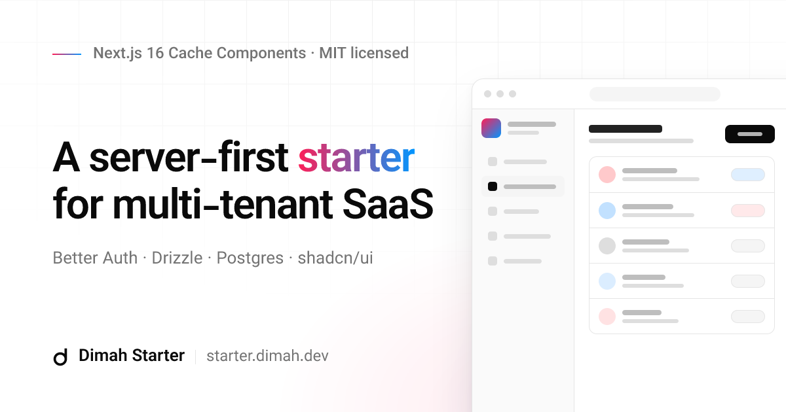

# Dimah Starter

**Server-first Next.js 16 starter for multi-tenant SaaS.** Auth, organizations, roles and an admin panel come wired on Cache Components and Better Auth, so day one goes to your product.

[](https://github.com/dimah-kz/dimah-starter/actions/workflows/ci.yml)
[](./LICENSE)
[](https://nextjs.org)
[](https://www.typescriptlang.org)

**[Live demo](https://starter.dimah.dev)** · **[Use this template](https://github.com/dimah-kz/dimah-starter/generate)** · [Quick start](#quick-start) · [How it works](#how-it-works) · [Production](#production)

[](https://starter.dimah.dev)

## Quick start

Needs Node.js ≥ 22.12, pnpm 12 and a PostgreSQL database.

```bash
pnpm install
cp .env.example .env              # set DATABASE_URL and BETTER_AUTH_SECRET
pnpm --filter @repo/db db:migrate
pnpm dev                          # http://localhost:3000
```

No other service is required to start: without `RESEND_API_KEY` emails print to the server log, and S3 settings are only read by uploads.

<details>
<summary>Make yourself platform admin</summary>

Sign up, verify the email (without Resend, the link is in the server log), then:

```sql
UPDATE auth."user" SET role = 'admin' WHERE email = 'you@example.com';
```

Sign in again to see **Platform management**; later admins are promoted from `/dashboard/admin/users`.

</details>

## Features

| Area              | What you get                                                                                                          |
| ----------------- | --------------------------------------------------------------------------------------------------------------------- |
| **Auth**          | Email + password, Google, passkeys, two-factor (TOTP + backup codes), email verification, password reset, rate limits |
| **Multi-tenancy** | Organizations, email invitations, owner / admin / member roles, organization switcher and logo                        |
| **Admin panel**   | Search and filter users, ban / unban, platform roles, organizations overview                                          |
| **Account**       | Profile and avatar, email and password change, passkeys, 2FA, connected accounts, active sessions, theme, language    |
| **Uploads**       | Direct-to-bucket on any S3-compatible storage (R2, S3, MinIO) with [dimah-s3](https://s3.dimah.dev), quotas, purge    |
| **i18n**          | [next-intl](https://next-intl.dev), English and Persian with a real RTL layout, localized dates, numbers and errors   |
| **Product API**   | [oRPC](https://orpc.dev) router, called in-process from Server Actions or over HTTP                                   |
| **SEO**           | Metadata, RTL-safe share images ([Takumi](https://takumi.kane.tw)), sitemap, robots, JSON-LD, `llms.txt`              |
| **Quality**       | Strict TypeScript, ESLint, Prettier, Vitest, Playwright, Turborepo caching, GitHub Actions CI                         |

**Stack:** Next.js 16 · React 19 · TypeScript · Better Auth · Drizzle ORM · PostgreSQL · oRPC · Tailwind CSS 4 · shadcn/ui (Base UI) · next-intl · Resend · Turborepo · pnpm

## How it works

No auth client, no React Query, no client data layer. The server owns sessions, permissions and data:

- **Read** — a Server Component checks the session and permission per request, then reads through a `'use cache'` function tagged per user or organization. Sessions are never cached.
- **Write** — a Server Action calls `auth.api` (users, organizations, roles) or the oRPC router (your product), then `updateTag`, so the person who acted sees fresh data in the same response.
- **Upload** — the browser sends the file straight to the bucket with a signed ticket; the action stores the URL and deletes the old object in `after()`.

```ts
// Read: gate per request, then a tagged cache entry
export async function getOrganizationMembersPage(query) {
  const { organizationId } = await requireOrganizationManager()
  return getCachedPage(organizationId, query)
}

async function getCachedPage(organizationId, query) {
  "use cache"
  cacheLife("minutes")
  cacheTag(tags.organizationMembersById(organizationId))
  return db.select().from(member) // …
}

// Write: a Server Action that expires exactly what it changed
export async function removeOrganizationMemberAction(input) {
  await auth.api.removeMember({ headers: await headers(), body })
  updateTag(tags.organizationMembersById(input.organizationId))
}
```

`cacheComponents` and `partialPrefetching` are on in [`next.config.ts`](./apps/web/next.config.ts): links prefetch each route's shell, so navigation paints at once and signed-in parts stream in (Playwright checks it with `instant()`). React Compiler and Turbopack are on too. The rules (what to cache, which tag to expire) are in [nextjs.md](./docs/agents/nextjs.md).

## Project structure

```
apps/web/          Next.js app: landing page, auth, dashboard, admin
packages/
  api/             oRPC product router (in-process caller + /api/rpc)
  auth/            Better Auth config, roles and permissions
  db/              Drizzle schema, client and migrations
  email/           Resend + React Email
  i18n/            Messages, locales, formatters
  storage/         dimah-s3 upload routes and object cleanup
  ui/              shadcn/ui, ReUI and Dimah components
tooling/           Shared ESLint, TypeScript and Vitest configs
docs/agents/       Task guides for contributors and AI agents
```

Logic lives in `packages/`, routes and feature UI in `apps/web`. A second app (mobile, extension) sits beside it in `apps/` and reuses the packages.

## Scripts

| Command                                              | Does                                          |
| ---------------------------------------------------- | --------------------------------------------- |
| `pnpm dev`                                           | Run the web app                               |
| `pnpm lint` · `typecheck` · `format:check` · `build` | Quality gates (CI runs all of them)           |
| `pnpm test` · `test:watch` · `test:e2e`              | Vitest unit tests · Playwright e2e            |
| `pnpm --filter @repo/db db:generate` · `db:migrate`  | Create and apply migrations                   |
| `pnpm --filter @repo/db db:studio`                   | Browse the database                           |
| `pnpm ui:sync`                                       | Regenerate shadcn / ReUI components           |
| `pnpm storage:purge`                                 | Remove abandoned uploads (schedule it hourly) |
| `pnpm docs:check`                                    | Check that links and paths in the docs exist  |

## Build on it

1. **Rebrand** — name and description in `packages/i18n/src/messages/*/common.json`, colors in `packages/ui/src/styles/globals.css`, landing page and `llms.txt` in `apps/web/src/app/(marketing)/`, links in `apps/web/src/lib/site.ts`. Then update `package.json`, this README, `CONTRIBUTING.md`, `SECURITY.md` and `LICENSE`.
2. **Add a procedure** — one file in `packages/api/src/routers/<domain>/` ([api.md](./docs/agents/api.md)).
3. **Add a page** — copy a sibling under `apps/web/src/app/dashboard/` and its action under `app/action/` ([dashboard.md](./docs/agents/dashboard.md)).
4. **Add tables** — Drizzle schema in `packages/db`, then `db:generate` and `db:migrate`.
5. **Test it** — a `*.test.ts` beside the logic, an e2e spec per flow ([testing.md](./docs/agents/testing.md)).

**Using an AI agent?** [`AGENTS.md`](./AGENTS.md) and [`docs/agents/`](./docs/agents) tell Claude Code, Codex, Cursor or Copilot where code goes and how to check it. With the [Next.js MCP server](./docs/agents/nextjs.md#where-to-check-an-api) connected, they read the running app's errors too.

## Production

Runs anywhere Next.js runs on Node.js: Vercel, a container or your own server.

<details>
<summary>Checklist before you go live</summary>

- **Public URL** — set `BETTER_AUTH_URL` to the public origin. Canonicals, the sitemap and share images use it.
- **Postgres on serverless** — use a **pooled** `DATABASE_URL` (Neon, Supabase, PgBouncer); direct connections run out under bursty functions.
- **Session cookie cache** — `getSession` may trust a cookie for up to 5 minutes, so a banned or demoted user can look signed-in until it expires.
- **Rate limits** — counters live in Postgres. Better Auth limits `/api/auth`; sign-in, sign-up, reset, 2FA, passkey and Google actions call `consumeRateLimit` per address and account. Behind several proxies, set `advanced.ipAddress`.
- **Product API** — `/api/rpc` rejects cross-site requests and allows 300 calls a minute per IP ([api.md](./docs/agents/api.md)).
- **Security headers** — framing denied, `nosniff`, `Referrer-Policy`, `Permissions-Policy`, HSTS in production. Add a script CSP if you need one.
- **Email** — set `RESEND_API_KEY` and `EMAIL_FROM`.
- **Storage** — allow `GET`, `PUT` and `HEAD` from your origin in the bucket CORS, serve objects at `S3_PUBLIC_BASE_URL`, and run `pnpm storage:purge` hourly; [`storage-purge.yml`](./.github/workflows/storage-purge.yml) does it once its secrets are set ([details](./packages/storage/README.md#purging-stale-uploads)).
- **SEO** — set `GOOGLE_SITE_VERIFICATION` and submit `/sitemap.xml` ([seo.md](./docs/agents/seo.md)).
- **Testing API** — `EXPOSE_TESTING_API=1` is for the e2e build only. Never deploy with it.

</details>

## FAQ

**Free for commercial use?** Yes, MIT. Keep the license notice in copies of the code.

**Why no client data library?** Server Components and Server Actions cover reads and writes and keep permissions on the server. Add one for a live feature that needs it.

**Can I drop Persian or multi-tenancy?** Yes. Remove a locale with [these steps](./docs/agents/i18n.md#remove-a-locale); remove a dashboard area by deleting its route folder, `action/` folder and keys.

**What's not included?** Billing, a CMS and analytics, so you pick the provider.

## Contributing

Issues and PRs are welcome; read [CONTRIBUTING.md](./CONTRIBUTING.md). Report security issues privately ([SECURITY.md](./SECURITY.md)). If it saves you time, a ⭐ helps others find it.

## License

[MIT](./LICENSE) © [dimah-kz](https://github.com/dimah-kz)
