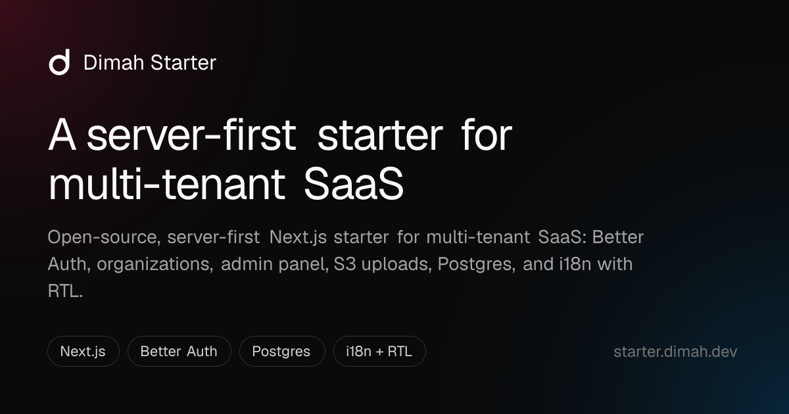
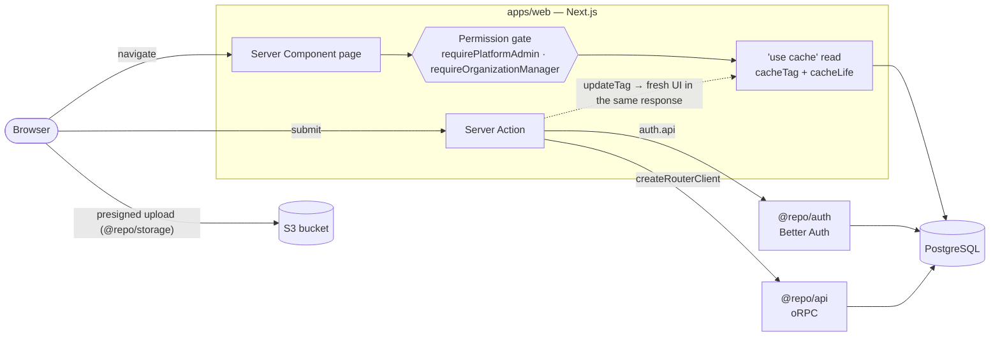

# Dimah Starter

**Open-source, server-first Next.js 16 starter for multi-tenant SaaS.** Sign-in, organizations with roles, an admin panel, file uploads and English/Persian (RTL) work from the first run — so you start on the feature that makes your product different, not on the login page.

[](https://github.com/dimah-kz/dimah-starter/actions/workflows/ci.yml)
[](./LICENSE)
[](https://nextjs.org)
[](https://www.typescriptlang.org)

**[Live demo](https://starter.dimah.dev)** · **[Use this template](https://github.com/dimah-kz/dimah-starter/generate)** · [Quick start](#quick-start) · [Cache Components](#built-on-nextjs-16-cache-components) · [Architecture](#how-it-works) · [FAQ](#faq)

[](https://starter.dimah.dev)

## Why this starter

Most SaaS kits give you a client SDK, a data-fetching library and drop-in widgets, then leave the hard parts — tenants, roles, caching, permissions on the server — to you. Dimah Starter goes the other way:

- **Server-first, end to end.** Pages read the session in Server Components, lists come from tagged `'use cache'` reads, and every write is a Server Action. No auth client, no React Query, no client data layer to keep in sync.
- **Multi-tenant from day one.** Organizations, invitations, member roles and a platform admin panel are built and wired to [Better Auth](https://www.better-auth.com) — with permission checks on every page _and_ every data read, not just in layouts.
- **Next.js 16 as it is meant to be used.** Built on [Cache Components](#built-on-nextjs-16-cache-components) and Partial Prefetching — not an older App Router kit with a version bump — plus React 19 with the React Compiler, and Turbopack.
- **Production details already done.** Rate-limited auth, security headers, safe redirects, upload quotas, a stale-upload purge, CI, and a production checklist below.
- **Global from the start.** Every string lives in message files; English and Persian ship with a correct right-to-left layout.
- **Made to be extended by AI agents.** [`AGENTS.md`](./AGENTS.md), task guides in [`docs/agents/`](./docs/agents) and [Cursor rules](./.cursor/rules) tell Claude Code, Cursor or Codex where code goes and which patterns to copy.

## Built on Next.js 16 Cache Components

`cacheComponents` and `partialPrefetching` are on in [`next.config.ts`](./apps/web/next.config.ts), and every feature follows the model instead of working around it:

| Next.js 16                                                    | In this starter                                                                                                                                                                                          |
| ------------------------------------------------------------- | -------------------------------------------------------------------------------------------------------------------------------------------------------------------------------------------------------- |
| **Cache Components** — `'use cache'`, `cacheTag`, `cacheLife` | Every list and profile read is a cache entry tagged per user or organization, e.g. the [members list](<./apps/web/src/app/dashboard/(organization)/manage/members/lib/get-organization-members-page.ts>) |
| **Partial Prefetching**                                       | Links prefetch each route's static shell. Every dashboard page builds as a partial prerender: the frame shows at once, the signed-in parts stream in                                                     |
| **`updateTag`**                                               | A Server Action expires exactly the tags it changed, and the person who acted sees fresh data in the same response — no `router.refresh()`, no client cache                                              |
| **`refresh()` · `after()`**                                   | Lists without a tag re-render from the action; storage cleanup runs after the response is sent                                                                                                           |
| **Server Actions**                                            | Every write — auth, organizations, admin, uploads — is one file under `app/action/`, mirroring its route                                                                                                 |
| **React Compiler · Turbopack**                                | No hand-written `useMemo` / `useCallback`; fast dev server and builds                                                                                                                                    |

A read and a write, trimmed from the dashboard:

```ts
// Read: a permission gate per request, then a tagged cache entry
export async function getOrganizationMembersPage(query) {
  const { organizationId } = await requireOrganizationManager()
  return getCachedPage(organizationId, query)
}

async function getCachedPage(organizationId, query) {
  "use cache"
  cacheLife("minutes")
  cacheTag(tags.organizationMembersById(organizationId))
  return db.select().from(member) // …
}

// Write: a Server Action; the change shows in the same response
export async function removeOrganizationMemberAction(input) {
  await auth.api.removeMember({ headers: await headers(), body })
  updateTag(tags.organizationMembersById(input.organizationId))
}
```

The rules behind it — what to cache, which tag to expire, why sessions are never cached — are in [caching.md](./docs/agents/caching.md) and [implementation.md](./docs/agents/implementation.md).

## What's inside

| Area              | Included                                                                                                          |
| ----------------- | ----------------------------------------------------------------------------------------------------------------- |
| **Auth**          | Email + password, Google sign-in, email verification, password reset, session list and revoke, rate limiting      |
| **Organizations** | Create and switch organizations, invite by email, owner / admin / member roles, organization logo, delete         |
| **Admin panel**   | Search and filter users, ban / unban, platform roles, organizations overview                                      |
| **Account**       | Profile and avatar, password change, active sessions                                                              |
| **Uploads**       | Direct-to-bucket uploads on any S3-compatible storage (R2, S3, MinIO) with [dimah-s3](https://s3.dimah.dev)       |
| **Email**         | Transactional email with [Resend](https://resend.com) and React Email; printed to the log in development          |
| **i18n**          | [next-intl](https://next-intl.dev), English and Persian, RTL, localized dates and numbers, translated auth errors |
| **Product API**   | [oRPC](https://orpc.dev) router in `@repo/api`, called in-process from Server Actions or over HTTP                |
| **UI**            | [shadcn/ui](https://ui.shadcn.com) on Base UI, [ReUI](https://reui.io), Tailwind CSS 4, dark mode                 |
| **SEO**           | Metadata, Open Graph image, sitemap, robots, JSON-LD and a public landing page                                    |
| **Quality**       | Strict TypeScript, ESLint, Prettier, Turborepo caching, GitHub Actions CI                                         |

**Stack:** Next.js 16 · React 19 · TypeScript · Better Auth · Drizzle ORM · PostgreSQL · oRPC · Tailwind CSS 4 · shadcn/ui · next-intl · Resend · Turborepo · pnpm

## How it works



- **Read:** a page checks the session and permission, then reads through a `'use cache'` function tagged per user or organization. Sessions are never cached.
- **Write:** a Server Action calls `auth.api` (auth, organizations, admin) or the oRPC router (your product), then `updateTag` so the person who acted sees the change in the same response.
- **Upload:** the browser sends the file straight to the bucket with a signed ticket; the action stores the public URL and cleans up the previous file after the response.

## Quick start

**You need:** Node.js ≥ 22, pnpm 12, a PostgreSQL database and, for uploads, an S3-compatible bucket.

```bash
pnpm install
cp .env.example .env          # fill in DATABASE_URL, BETTER_AUTH_*, then the optional blocks
pnpm --filter @repo/db db:migrate
pnpm dev
```

Open [http://localhost:3000](http://localhost:3000). Without `RESEND_API_KEY`, verification and reset emails are printed to the server log. The app starts without S3 settings; only uploads need them.

**First platform admin.** Sign up, verify the email, then grant the role once:

```sql
UPDATE auth."user" SET role = 'admin' WHERE email = 'you@example.com';
```

Sign in again to see **Platform management** in the sidebar. Later admins are promoted from `/dashboard/admin/users`.

| Command                                              | What it does                                    |
| ---------------------------------------------------- | ----------------------------------------------- |
| `pnpm dev`                                           | Run the web app                                 |
| `pnpm format:check` · `lint` · `typecheck` · `build` | Quality gates (CI runs all of them)             |
| `pnpm --filter @repo/db db:generate` · `db:migrate`  | Create and apply migrations                     |
| `pnpm --filter @repo/db db:studio`                   | Browse the database                             |
| `pnpm ui:sync`                                       | Regenerate shadcn / ReUI components             |
| `pnpm storage:purge`                                 | Clean up abandoned uploads (schedule it hourly) |

## Project structure

```
dimah-starter/
├── apps/
│   └── web/                 # Next.js app: landing page, auth, dashboard, admin
├── packages/
│   ├── api/                 # Product oRPC router (in-process caller + /api/rpc)
│   ├── auth/                # Better Auth config, roles and permissions
│   ├── db/                  # Drizzle schema, client and migrations
│   ├── email/               # Transactional email (Resend + React Email)
│   ├── i18n/                # Messages, locales and formatters
│   ├── storage/             # dimah-s3 upload routes and object cleanup
│   └── ui/                  # shadcn/ui, ReUI and Dimah components
├── tooling/                 # Shared ESLint and TypeScript configs
└── docs/agents/             # How-to guides for contributors and AI agents
```

Core logic lives in `packages/`, feature UI in `apps/`. `apps/mobile` and `apps/extension` are reserved slots: a future app reuses the same packages.

## Build your product on it

1. **Brand it** — app name and description in `packages/i18n/src/messages/*/common.json`, colors in `packages/ui/src/styles/globals.css`, the landing page in `apps/web/src/app/(marketing)/`.
2. **Add a procedure** — one file per procedure in `packages/api/src/routers/<domain>/` ([api.md](./docs/agents/api.md)).
3. **Add a page** — copy a sibling under `apps/web/src/app/dashboard/`, its action under `app/action/`, and register its URL, labels and cache tags ([dashboard.md](./docs/agents/dashboard.md)).
4. **Add tables** — Drizzle schema in `packages/db`, then `db:generate` and `db:migrate`.

Working with an AI agent? Point it at [`AGENTS.md`](./AGENTS.md) first — it indexes the guides and the rules every change must follow.

## FAQ

**Is it free for commercial use?**
Yes. It is MIT licensed: use it for client work or your own SaaS. Keep the license notice in copies of the code; nothing else is required.

**Why no client-side data library?**
Server Components and Server Actions already cover reads and writes, and keep sessions, permissions and database access on the server. The UI ships less JavaScript and has one source of truth. You can still add a client library for a live feature that needs one.

**Where can I deploy it?**
Anywhere that runs Next.js on Node.js — Vercel, a container, or your own server. On serverless, use a pooled Postgres URL (see [Production](#production)).

**Do I have to keep Persian or multi-tenancy?**
No. Remove a locale with the steps in [i18n.md](./docs/agents/i18n.md#remove-a-locale) — the language switcher hides itself with one locale — and remove a dashboard area by deleting its route folder, its `action/` folder and its keys. The layout stays correct for left-to-right and right-to-left either way.

**How is it different from other Next.js SaaS starters?**
It is server-first rather than client-SDK-first, multi-tenant with real permission checks, current with Next.js 16 Cache Components, and documented for AI coding agents. It does not include billing yet — see the next question.

**What is not included?**
Billing, a marketing CMS and analytics are left to you, so you can pick the provider that fits your product.

## Production

<details>
<summary>Checklist before you go live</summary>

- **Public URL** — set `BETTER_AUTH_URL` to the public origin. `http://localhost:3000` is trusted only outside production.
- **Postgres on serverless** — use a **pooled** `DATABASE_URL` (Neon pooler, PgBouncer, Supabase pooler). Direct `5432` connections run out under bursty functions.
- **Session cookie cache** — `getSession` may use a cookie for up to **5 minutes**. After a ban or role change, the affected user can still look signed-in until that cache expires.
- **Auth rate limit** — counters live in Postgres so they survive serverless. Better Auth limits its HTTP routes (`/api/auth`); the sign-in, sign-up and password-reset Server Actions call `consumeRateLimit` first. Behind more than one proxy, set Better Auth `advanced.ipAddress` so the client IP is right.
- **Security headers** — `next.config.ts` denies framing and sets `nosniff`, `Referrer-Policy`, `Permissions-Policy` and, in production, HSTS. Add a script CSP if you need one.
- **SEO** — canonicals, `sitemap.xml`, `robots.txt`, `llms.txt` and the share image use `BETTER_AUTH_URL`. Set `GOOGLE_SITE_VERIFICATION`, then submit `/sitemap.xml` in Search Console. Public pages go in `apps/web/src/app/(marketing)/` — [seo.md](./docs/agents/seo.md).
- **Email** — set `RESEND_API_KEY` and `EMAIL_FROM`. Without a key, development prints the message (including the link) to the server log.
- **Storage** — allow `GET`, `PUT` and `HEAD` from your origin in the bucket CORS, serve objects at `S3_PUBLIC_BASE_URL`, and schedule `pnpm storage:purge` hourly so uploads that never confirm leave the bucket and the database — [packages/storage](./packages/storage/README.md#purging-stale-uploads).

</details>

## Contributing

Issues and pull requests are welcome — read [CONTRIBUTING.md](./CONTRIBUTING.md) first. Report security issues privately as described in [SECURITY.md](./SECURITY.md).

If this starter saves you time, a ⭐ helps other developers find it.

## License

[MIT](./LICENSE) © [dimah-kz](https://github.com/dimah-kz)
